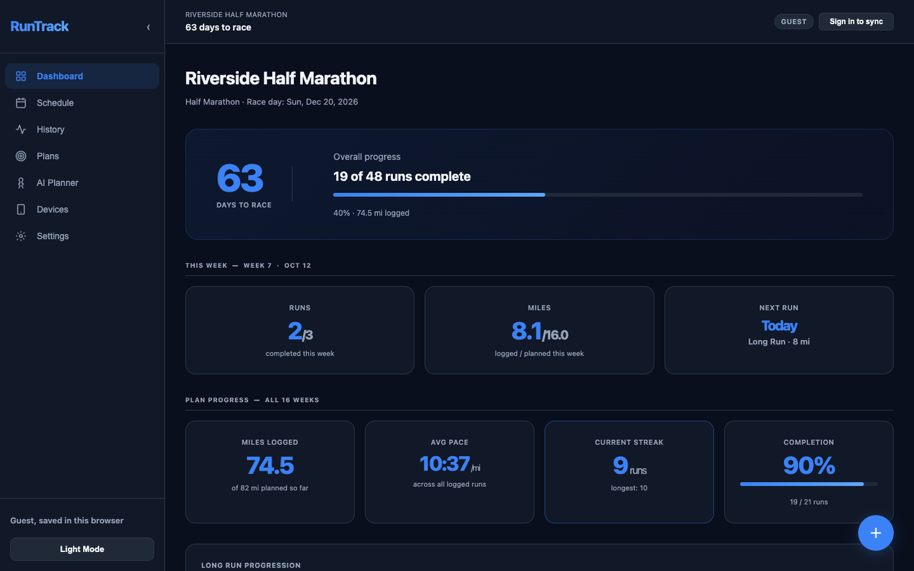
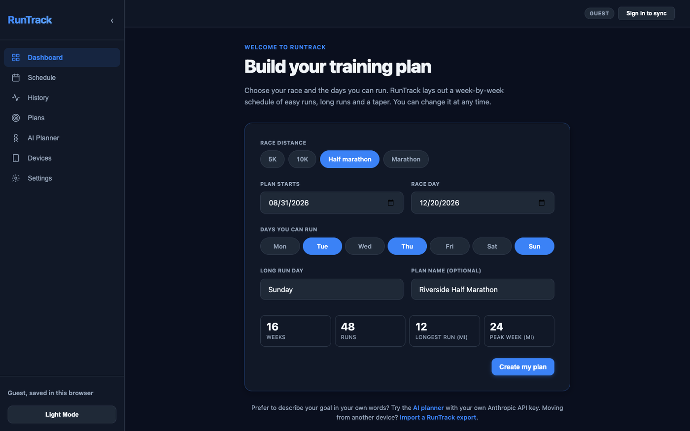
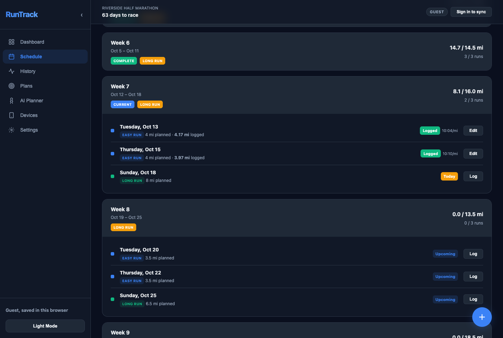
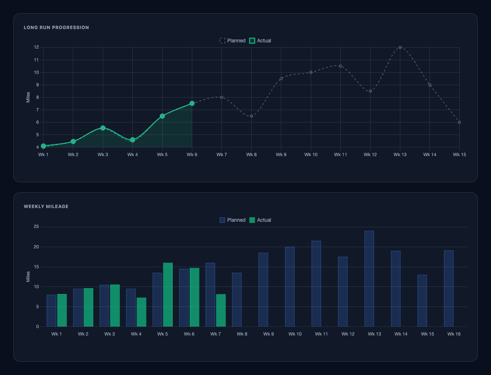
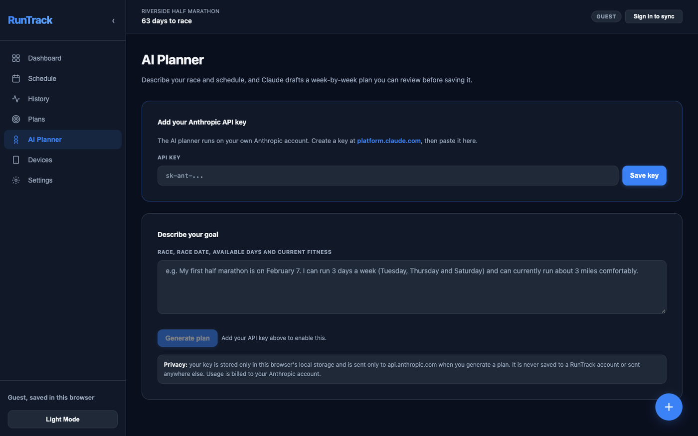
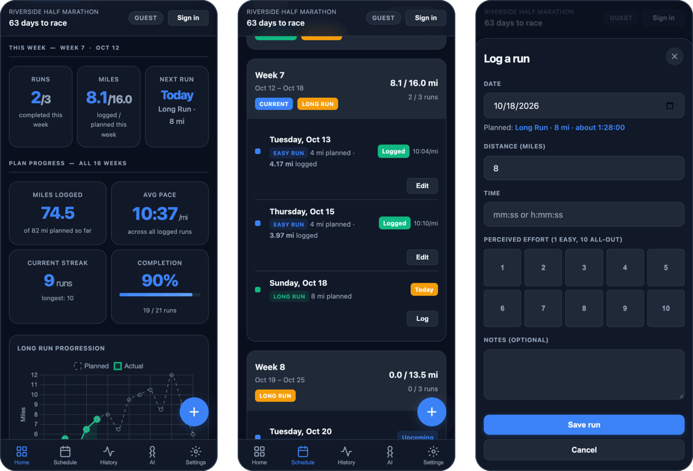

# RunTrack

RunTrack is a free training planner and run log for people preparing for a race. Choose a 5K, 10K, half marathon or marathon, pick the days you can run, and RunTrack lays out a week-by-week plan of easy runs, long runs and a taper. Log each run and follow your progress on the dashboard and charts. It runs in your browser with no sign-up and no build step, and your data stays on your device unless you connect a Firebase project of your own to sync it.



| Build a plan | Follow the schedule |
| --- | --- |
|  |  |
| **Track your progress** | **Draft a plan with AI** |
|  |  |



<sub>Screenshots show guest mode with fictional demo data.</sub>

## Run it locally

RunTrack is a static site with nothing to install. Clone it and serve the folder with any static file server:

```sh
git clone https://github.com/Bakar404/RunTrack.git
cd RunTrack
python3 -m http.server 8000
```

Then open http://localhost:8000. Serve it over http rather than opening `index.html` as a file, because sign-in and device connections need a real origin.

Out of the box RunTrack runs in guest-only mode and never contacts Firebase. Accounts and sync are optional and use a Firebase project of your own; see [Accounts with your own Firebase project](#accounts-with-your-own-firebase-project).

## Features

- **Plans built around your week.** Enter your race distance, race date, start date, run days and long-run day. Mileage builds steadily, every fourth week is a lighter cutback week, and the last weeks taper into race day. Each distance has a minimum plan length (4 weeks for a 5K, up to 12 for a marathon) and plans can run up to 30 weeks.
- **Dashboard.** Countdown to race day, this week's runs and miles, your next run, total miles, average pace, streaks and completion.
- **Run log.** Distance, time, automatic pace, perceived effort and notes. Runs on rest days still count toward your weekly mileage.
- **Schedule.** Every week of the plan with the status of each run, and an `.ics` export for Google Calendar, Apple Calendar or Outlook.
- **Missed-run adjustments.** When you miss easy runs, RunTrack offers to spread some of that mileage over your next easy runs.
- **Charts.** Long-run progression and weekly mileage, planned against actual.
- **Several plans.** Edit or rebuild a plan without losing logged runs, or start a new one. Earlier plans are kept.
- **AI planner (optional).** Describe your goal in your own words and Claude drafts a plan for you to review before saving. It uses your own Anthropic API key.
- **Device import (optional).** Fitbit runs and heart rate zones, and Whoop recovery and workouts, through developer apps that you register yourself.
- **Portable data.** JSON export and import (merge or replace), light and dark themes, and a phone layout with bottom navigation.

## Using RunTrack

### Use it as a guest

Choose **Start without an account** and build your plan. Everything is saved in this browser's localStorage. It survives reloads, but clearing the site's data deletes it, so use **Settings > Export JSON** to keep a backup or to move to another browser.

### Sign in to sync (optional)

Once [your own Firebase project](#accounts-with-your-own-firebase-project) is set in `config.js`, the landing page and Settings offer sign-in. Create an account with a username and password to back up your plans and runs and use them on several devices. No email address is needed, which also means a forgotten password cannot be reset.

- Account data is stored in Cloud Firestore under your user ID, and only you can read or write it.
- If the browser already holds guest data when you sign in, RunTrack offers to import it. Nothing in your account is overwritten.
- Guest data and account data are kept separate. Signing out removes the account's copy from that browser and leaves guest data alone.

### AI planner with your own key (optional)

1. Create an API key at [platform.claude.com](https://platform.claude.com/settings/keys).
2. Paste it on the **AI Planner** page, then describe your race, race date, available days and current fitness.
3. Review the draft and save it as a plan.

Where the key goes:

- **Storage.** The key is kept only in this browser's localStorage, for the current guest or account profile. It is never synced to your account, put in a URL or logged.
- **Requests.** Plans are requested directly from your browser to `https://api.anthropic.com/v1/messages`, with no RunTrack server in between. Usage is billed to your Anthropic account.
- **Removing it.** **Forget key**, on the AI Planner page or in Settings, deletes the key from the browser.
- **Model.** The default model is `claude-sonnet-5-5`, set by the `DEFAULT_AI_MODEL` constant in `script.js`. You can enter a different model ID in Settings.

### Fitbit (optional)

> Google is shutting down the Fitbit Web API on October 30, 2026 and no longer accepts new Fitbit developer apps. These steps only work with an app you already have, and only until that date.

1. Register an app at [dev.fitbit.com](https://dev.fitbit.com/apps), or open the one you already have. Set **OAuth 2.0 Application Type** to **Personal**, **Default Access Type** to **Read Only**, and the **Callback URL** to the exact address shown under **Settings > Fitbit**.
2. Paste the app's **OAuth 2.0 Client ID** into **Settings > Fitbit** and choose **Connect Fitbit**.

A Personal app can only read the Fitbit account that registered it, which is why each person uses their own app. RunTrack connects with OAuth 2.0 and PKCE, so no client secret is involved, and your tokens stay in this browser.

### Whoop (advanced, self-hosted)

Whoop only issues tokens to requests that include your client secret, and a secret must never be shipped in a website. Connecting Whoop therefore needs a small token proxy that you host yourself.

1. Create an app in the [Whoop Developer Dashboard](https://developer-dashboard.whoop.com). Set the **Redirect URI** to the address shown in RunTrack, and choose the scopes `read:recovery`, `read:workout` and `offline`.
2. Deploy the token proxy from the **Devices** page. It is written for Cloudflare Workers and is short enough to port to other platforms. Store `WHOOP_CLIENT_ID` and `WHOOP_CLIENT_SECRET` as secrets, and set `ALLOWED_ORIGIN` to the origin of your RunTrack site.
3. Under **Settings > Whoop**, enter your Client ID and the proxy's https URL, then choose **Connect Whoop**.

The proxy only adds your secret to token requests. The browser fetches Whoop data directly, and the tokens stay in this browser.

## Accounts with your own Firebase project

`config.js` ships with `firebase: null`, which keeps RunTrack in guest-only mode: the sign-in panel is hidden and the app never contacts Firebase. To turn on accounts and sync:

1. Create a project in the [Firebase console](https://console.firebase.google.com). Add a Web app and paste its config into `config.js` in place of `null`.
2. Under **Authentication > Sign-in method**, enable **Email/Password**.
3. Under **Authentication > Settings > Authorized domains**, add the domain you host on. `localhost` is allowed by default.
4. Create a **Cloud Firestore** database in production mode.
5. Deploy the security rules with the Firebase CLI. `firebase.json` points the CLI at `firestore.rules`.

   ```sh
   npm install -g firebase-tools
   firebase login
   firebase deploy --only firestore:rules --project <your-project-id>
   ```

   Alternatively, paste the contents of `firestore.rules` into **Firestore > Rules** in the console.

Set `firebase` back to `null` to return to guest-only mode.

**Putting your copy online.** Any static host works, such as GitHub Pages, Netlify or Cloudflare Pages; the `.nojekyll` file lets GitHub Pages serve the files as they are. Add the host's domain to Firebase's authorized domains if you use accounts, and register the new address as the Fitbit Callback URL or Whoop Redirect URI if you use those.

## Privacy and security

- **No RunTrack server.** The site is static, with no analytics, ads or tracking. Besides loading Chart.js from jsDelivr, it only contacts Firebase when you use an account, Anthropic when you generate an AI plan, and Fitbit or Whoop when you connect them.
- **Guest data** stays in this browser's localStorage and is never uploaded.
- **Account data** lives in Cloud Firestore under `users/{uid}`, where `firestore.rules` applies least privilege:
  - only the signed-in owner can read or write their own documents;
  - profile, plan and run writes are checked for the expected shape;
  - all other access is denied, including listing users.
- **Usernames.** Firebase Email/Password sign-in needs an email-style login, so usernames are mapped to a placeholder address (`username@runtrack.local`). No real email address is collected.
- **Keys and tokens** (your Anthropic key, and Fitbit and Whoop tokens) stay in this browser's localStorage and are never synced to an account. Each is sent only to its own provider; Whoop token requests also go through the proxy you host.
  - Anyone with access to your browser profile can read localStorage. Prefer an Anthropic key with a spending limit, and choose **Forget key** on shared computers.
- **Firebase web config.** `config.js` ships without one. A web config you add identifies your Firebase project and is not a secret; the security rules control access. You can also restrict the API key to your domains in the Google Cloud console. You can also restrict the API key to your domains in the Google Cloud console.
- **Third-party code** is limited to two sources:
  - Chart.js, pinned with a Subresource Integrity hash;
  - the Firebase SDK, which loads only when you sign in or create an account.
- **Untrusted input.** Text you enter is escaped before it is rendered, and imported files are validated and size-limited.

## Tech stack

- HTML, CSS and vanilla JavaScript, with no framework, bundler or build step
- [Chart.js](https://www.chartjs.org) 4.4 for charts
- Firebase Authentication (Email/Password) and Cloud Firestore with offline persistence, through the Firebase compat SDK 10.12, loaded on demand
- Anthropic Messages API for the AI planner
- Fitbit Web API (OAuth 2.0 with PKCE) and Whoop API v2 for device import

## Project structure

```text
index.html          Page structure: landing page, app shell, navigation and dialogs
script.js           Application logic: storage and sync, plan generation, rendering,
                    device integrations and the AI planner
styles.css          Dark and light themes and responsive layouts
config.js           Site configuration: null for guest-only mode (the default), or your Firebase web config
firestore.rules     Per-user Firestore security rules
firebase.json       Firebase CLI configuration for deploying the rules
favicon.svg         App icon
.nojekyll           Tells GitHub Pages to serve files as they are
docs/screenshots/   Images used in this README
```
